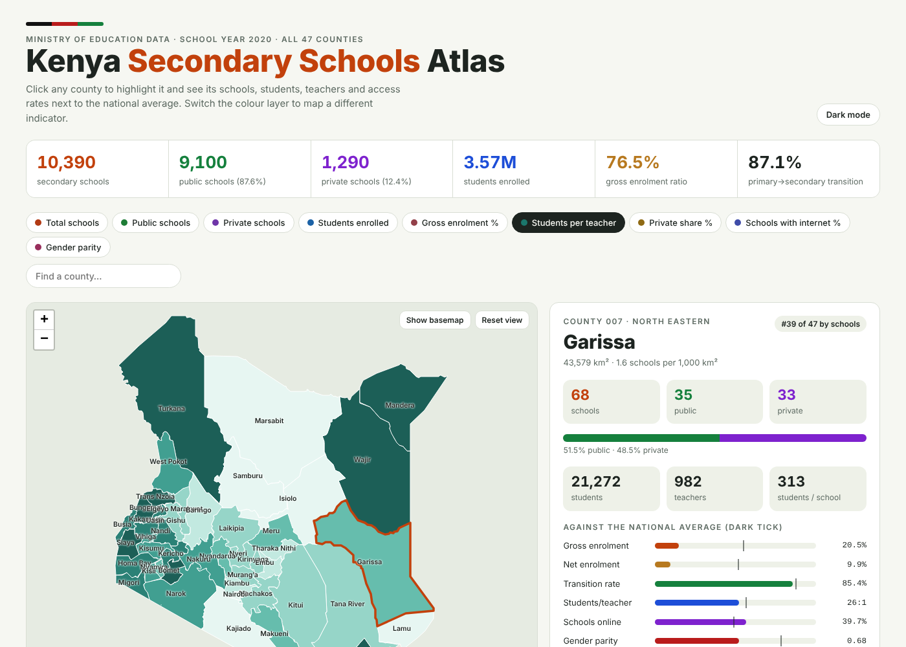

# Kenya Secondary Schools Atlas

An interactive geospatial atlas of secondary schools in all 47 Kenyan counties, built from the Ministry of Education's **Basic Education Statistical Booklet 2020** (NEMIS data).

**Live map:** https://jmsmuigai.github.io/kenya-secondary-schools-atlas/



## What it does
- Choropleth map of all 47 counties. Click a county to highlight it and see schools (public/private), students, teachers, students per school, and gross/net enrolment, transition, students per teacher, internet access and gender parity against the national average.
- Nine colour layers, county search, hover tooltips, optional basemap.
- Ranking chart, public vs private donut, schools vs enrolment bubble chart, gender parity chart and a sortable table of all counties, all linked to the map.
- Light and dark themes; works on phones.

## Key findings (2020)
| Indicator | Kenya |
|---|---|
| Secondary schools | 10,390 (9,100 public, 1,290 private) |
| Students | 3,569,279 |
| Gross / net enrolment | 76.5% / 54.1% |
| Primary to secondary transition | 87.1% |
| Students per teacher | 28 |

- The eight northern and north-eastern counties cover about 60% of Kenya's land but hold 4% of its secondary schools.
- Lowest gross enrolment: Mandera 18.7%, Marsabit 19.6%, Garissa 20.5%, Wajir 23.3%.
- Lowest gender parity (girls per boy): Mandera 0.54, Wajir 0.58, Turkana 0.62, Garissa 0.68.
- Private schools are 67% of schools in Nairobi and 61% in Mombasa.

Full write-up: [Kenya_Secondary_Schools_Report.pdf](Kenya_Secondary_Schools_Report.pdf)

## Repository layout
```
index.html                         interactive atlas (self-contained, data inline)
Kenya_Secondary_Schools_Report.pdf illustrated report (~1,000 words)
data/                              county dataset (CSV, JSON) and county boundaries (GeoJSON)
figures/                           maps and charts used in the report
scripts/                           Python used to build the data, figures and report
PROMPT_for_Antigravity_and_Claude.md  prompt for extending the system with an AI coding agent
```

## Run locally
Open `index.html` in a browser (internet needed for the Leaflet and Chart.js libraries), or:
```bash
python3 -m http.server 8000   # then visit http://localhost:8000
```

## Sources
- Ministry of Education, [Basic Education Statistical Booklet 2020](https://www.education.go.ke/sites/default/files/Docs/The%20Basic%20Education%20Statistical%20Booklet%202020%20(1).pdf), Annex III tables III.1 to III.13.
- County boundaries: [mikelmaron/kenya-election-data](https://github.com/mikelmaron/kenya-election-data) (IEBC-derived).

## Author
James Mukoma Mburu · TovuTech Limited
